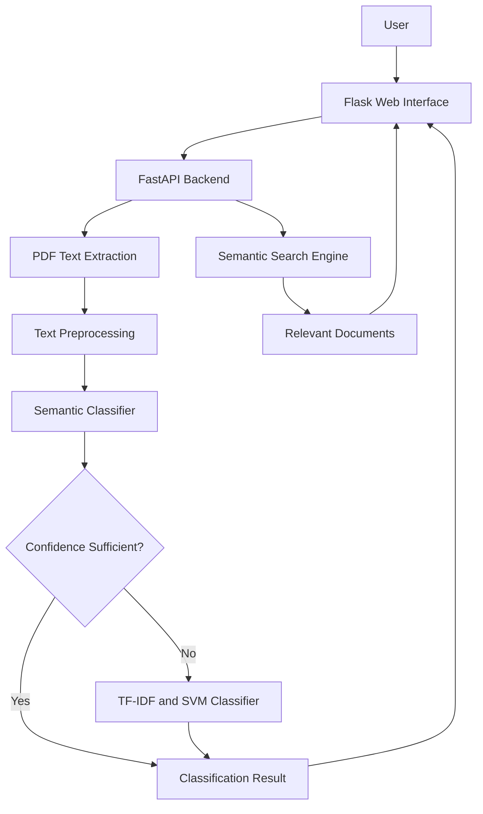

# Circulars AI Portal

**AI-Powered Classification & Semantic Search for Educational Circulars**

> End-to-end system to upload, classify, browse, and semantically search official PDF circulars using Artificial Intelligence, Machine Learning, and Natural Language Processing.

**Author:** Umm E Farwa Leelani ([GitHub Profile](https://github.com/farwaleelani8941648))

---

## Table of Contents

- [Overview](#overview)
- [Features](#features)
- [Tech Stack](#tech-stack)
- [System Architecture](#system-architecture)
- [Repository Structure](#repository-structure)
- [Prerequisites](#prerequisites)
- [Quick Start](#quick-start)
- [Data Preparation & Training](#data-preparation--training)
- [Run the Apps](#run-the-apps)
- [Usage](#usage)
- [Troubleshooting](#troubleshooting)
- [Roadmap](#roadmap)
- [Credits](#credits)
- [Contact](#contact)

---

## Overview

Circulars AI Portal is an intelligent document management system designed to automate the classification and retrieval of educational circulars.

The project provides an AI-powered document processing pipeline that:

- Extracts text from PDF documents.
- Detects circular numbers for deduplication and traceability.
- Automatically classifies documents into a fixed taxonomy:
  Main Category → Subcategory.
- Computes classification confidence scores.
- Falls back to a classic TF-IDF/SVM model when semantic confidence is low.
- Enables semantic search using natural-language queries.

A Flask frontend allows users to upload, browse, classify, and search documents, while a FastAPI backend exposes machine learning endpoints used by the web interface.

---

## Features

- **Hybrid Machine Learning:** Sentence-transformer embeddings combined with a TF-IDF/SVM fallback.
- **Automatic Document Classification:** Classification into main categories and subcategories.
- **Semantic Search:** Search documents by meaning rather than exact keyword matching.
- **PDF Text Extraction:** Automatic extraction of textual content from PDF documents.
- **Duplicate Detection:** Identification of duplicate documents through 4-digit circular numbers.
- **Confidence Scoring:** Confidence scores for document classification predictions.
- **Taxonomy-Based Browsing:** Structured navigation through document categories and subcategories.
- **Web Interface:** Flask-based interface for document upload, classification, and search.
- **REST API:** FastAPI backend for machine learning operations.
- **Model Training:** Scripts for dataset preparation, model training, and evaluation.

---

## Tech Stack

| Component | Technologies |
|---|---|
| Programming Language | Python |
| Backend API | FastAPI, Uvicorn |
| Frontend | Flask, Jinja2, HTML, CSS |
| Machine Learning | Scikit-learn, TF-IDF, SVM |
| Natural Language Processing | Sentence-Transformers, spaCy |
| Data Processing | Pandas |
| PDF Processing | PyMuPDF, pdfplumber |
| Semantic Indexing (Optional) | FAISS CPU |
| Version Control | Git, GitHub |

---

## System Architecture

The application follows a modular architecture that separates the frontend, backend, machine learning pipeline, and document processing components.



The hybrid classification approach combines semantic understanding with traditional machine learning techniques to support reliable document classification.

---

## Repository Structure

```text
project_root/
│
├── app/
│   ├── __init__.py
│   ├── main.py
│   ├── predict.py
│   └── search_engine.py
│
├── frontend/
│   ├── app.py
│   ├── static/
│   │   └── images/
│   └── templates/
│       ├── layout.html
│       ├── index.html
│       ├── category.html
│       ├── classification.html
│       └── searching.html
│
├── scripts/
│   ├── build_dataset.py
│   ├── clean_and_reset_dataset.py
│   ├── evaluate_classifier.py
│   ├── remove_test_circulars.py
│   ├── train_classifier.py
│   └── train_semantic_classifier.py
│
├── circulars_admin1.zip
├── circulars_admin2.zip
├── requirements.txt
└── README.md
```

### Main Components

| Directory | Description |
|---|---|
| `app/` | FastAPI backend, classification logic, and semantic search engine |
| `frontend/` | Flask web application and user interface |
| `frontend/static/` | Static resources, images, and visual assets |
| `frontend/templates/` | HTML templates |
| `scripts/` | Dataset preparation, training, and evaluation utilities |
| `circulars_admin*.zip` | Compressed PDF document datasets |
| `requirements.txt` | Python project dependencies |

> Note: Trained model files (`.pkl`) are not committed to the repository. Models must be trained locally as needed.

---

## Prerequisites

Before running the project, make sure the following tools are installed:

- Python 3.9–3.12 (tested on Python 3.10)
- pip
- Git

### Linux Dependencies

The following packages are helpful for PDF processing:

```bash
sudo apt update
sudo apt install -y poppler-utils libgl1
```

### French NLP Model

Install the French spaCy language model:

```bash
python -m spacy download fr_core_news_sm
```

---

## Quick Start

### 1. Clone the Repository

```bash
git clone https://github.com/farwaleelani8941648/finalprojectinnovation.git
cd finalprojectinnovation
```

### 2. Create a Virtual Environment

```bash
python -m venv venv
```

Activate the virtual environment.

**Windows:**

```bash
venv\Scripts\activate
```

**Linux / macOS:**

```bash
source venv/bin/activate
```

### 3. Install Dependencies

```bash
pip install --upgrade pip
pip install -r requirements.txt
```

Install the French spaCy language model:

```bash
python -m spacy download fr_core_news_sm
```

---

## Data Preparation & Training

### A. Prepare the PDF Dataset

Extract the provided ZIP archives into a directory named `circulars_admin/`.

The expected dataset structure is:

```text
circulars_admin/
├── MainCategory/
│   ├── Subcategory/
│   │   ├── document1.pdf
│   │   └── document2.pdf
```

Example:

```text
circulars_admin/
└── Staff_and_Personnel/
    └── Professional_Development/
        └── example.pdf
```

### B. Build the Dataset

From the project root, execute:

```bash
python scripts/build_dataset.py
```

This script extracts document text, classification labels, and circular numbers from the PDF dataset.

### C. Clean and Reset the Dataset (Optional)

```bash
python scripts/clean_and_reset_dataset.py
```

This script prepares the dataset for training when cleaning or resetting is required.

### D. Train the Classic Classifier

```bash
python scripts/train_classifier.py
```

The classic classification model uses:

- TF-IDF feature extraction.
- Support Vector Machine (SVM).
- Supervised document classification.

### E. Train the Semantic Classifier

```bash
python scripts/train_semantic_classifier.py
```

The semantic classifier uses sentence-transformer embeddings to capture the contextual meaning of documents.

### F. Evaluate Classification Performance (Optional)

```bash
python scripts/evaluate_classifier.py
```

This script evaluates classification performance.

After training, model artifacts are saved locally.

Re-run the dataset preparation and training process whenever new documents are added.

---

## Run the Apps

The application consists of two services that should run simultaneously.

### 1. Start the FastAPI Backend

Open a terminal from the project root and activate the virtual environment.

Run:

```bash
uvicorn app.main:app --reload --port 8000
```

The backend is available at:

- API: http://localhost:8000
- Interactive API documentation (Swagger UI): http://localhost:8000/docs
- Alternative API documentation: http://localhost:8000/redoc

### 2. Start the Flask Frontend

Open a second terminal and activate the virtual environment.

Navigate to the frontend directory:

```bash
cd frontend
```

Start the Flask application:

```bash
python app.py
```

Open your browser and visit:

http://localhost:5000

### Service Configuration

| Service | Port | URL |
|---|---|---|
| Flask Frontend | 5000 | http://localhost:5000 |
| FastAPI Backend | 8000 | http://localhost:8000 |
| Swagger API Documentation | 8000 | http://localhost:8000/docs |

---

## Usage

### Document Classification

1. Open the web application.
2. Navigate to the classification page.
3. Upload a PDF circular.
4. Submit the document for classification.
5. View the predicted main category, subcategory, and confidence score.

### Semantic Search

The semantic search engine allows users to search documents using keywords or natural-language queries.

Example queries:

- Teacher recruitment policy
- Professional development opportunities
- Educational regulations
- School administration procedures
- Staff and personnel management

The system retrieves relevant documents based on contextual meaning rather than exact keyword matching.

### Browse Circulars

Users can browse educational circulars by navigating through:

- Main categories.
- Subcategories.
- Available PDF documents.

### Duplicate Detection

Duplicate documents are identified using 4-digit circular numbers extracted during dataset preparation.

This mechanism supports document traceability and helps reduce duplicate entries.

---

## Troubleshooting

| Problem | Solution |
|---|---|
| PDF parsing errors | Ensure that the files are valid PDFs and install the required system dependencies. |
| Model not found | Execute the training scripts before starting the application. |
| Slow first search | Sentence-transformer models may require additional initialization time. |
| Windows path errors | Run scripts from the project root and verify relative paths. |
| Missing dependencies | Run `pip install -r requirements.txt`. |
| spaCy model not found | Run `python -m spacy download fr_core_news_sm`. |
| Backend connection error | Verify that the FastAPI backend is running on port 8000. |
| Frontend not available | Verify that the Flask application is running on port 5000. |
| Dataset not found | Verify that the ZIP archives have been extracted into the expected directory. |

---

## Roadmap

### Implemented Features

- [x] PDF text extraction
- [x] Document preprocessing
- [x] Dataset preparation
- [x] Hybrid document classification
- [x] TF-IDF and SVM classification
- [x] Sentence-transformer embeddings
- [x] Semantic document search
- [x] Confidence scoring
- [x] Duplicate document detection
- [x] Category-based document browsing
- [x] FastAPI backend
- [x] Flask web interface
- [x] Model evaluation scripts

### Future Improvements

- [ ] Modern and responsive user interface
- [ ] Docker and Docker Compose integration
- [ ] GitHub Actions CI/CD pipeline
- [ ] Automated unit and integration testing
- [ ] Administrative dashboard
- [ ] User authentication and authorization
- [ ] Classification performance monitoring
- [ ] Automated model retraining
- [ ] Advanced search filters
- [ ] Document management improvements
- [ ] Cloud deployment
- [ ] API security improvements
- [ ] Improved documentation and application screenshots

---

## Skills Demonstrated

This project demonstrates practical knowledge and experience in:

- Python development
- Artificial Intelligence
- Machine Learning
- Natural Language Processing
- Semantic Search
- Supervised Learning
- Document Classification
- PDF Processing
- Data Preprocessing
- Feature Engineering
- Model Training and Evaluation
- REST API Development
- Backend Development
- Web Application Development
- Frontend and Backend Integration
- Software Architecture
- Git and Version Control
- Technical Documentation

---

## Credits

**Developed by Umm E Farwa Leelani**

This project demonstrates the integration of Artificial Intelligence, Machine Learning, Natural Language Processing, and full-stack web development to address real-world document classification and information retrieval challenges.

---

## Contact

For professional inquiries, internship opportunities, collaboration, feedback, or technical questions:

- **Author:** Umm E Farwa Leelani
- **GitHub:** [farwaleelani8941648](https://github.com/farwaleelani8941648)
- **Project:** [Circulars AI Portal](https://github.com/farwaleelani8941648/finalprojectinnovation)
- **Issues:** [Report an issue](https://github.com/farwaleelani8941648/finalprojectinnovation/issues)

---

If you find this project interesting or useful, feel free to give the repository a star.

**Thank you for visiting this project!**
